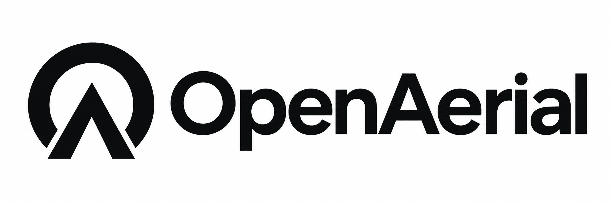

# OpenAerial

[中文](README.md) | [English](README.en.md)

OpenAerial aims to lower the barriers to building, developing, training, and deploying aerial intelligence systems. Through reproducible and extensible reference UAV platforms, we progressively share our mechanical designs, system integration, software, and workflows for simulation, data, training, and deployment. Our goal is to help developers, researchers, and universities worldwide pursue autonomous flight research and applications at an affordable cost, while contributing reusable results.



## Products

| Product | Workspace | Status | Released version |
| --- | --- | --- | --- |
| OpenAerial 150 | [openaerial-150](products/openaerial-150/README.en.md) | Planning; documentation in progress | None |

This repository currently provides a directory structure and documentation templates. Product specifications, designs, code, and validation records will be added as development progresses. These templates do not describe a system that is ready to manufacture or fly.

## Getting started

- Explore the first product: [OpenAerial 150](products/openaerial-150/README.en.md).
- Add products and organize files: [Product directory rules](products/README.en.md).
- Understand product and shared module boundaries: [Architecture and organization](docs/architecture.en.md).
- Set up tools and contribute: [Development](docs/development.en.md) and [Contributing](CONTRIBUTING.en.md).
- Prepare a reproducible version: [Release process](docs/releases.en.md).
- Review asset scope and terms: [Licensing and provenance](docs/licensing.en.md).

## Repository layout

```text
products/          Product designs, electronics, BOMs, firmware, software and reproduction guides
shared/            Original modules actually reused by multiple products
docs/              Platform documentation and collaboration rules
tools/             Tools for development, checking and packaging across products
resources/         Indexes for external datasets, weights and large logs
assets/branding/   Logos and brand assets
```

Each product has its own entry point. Shared modules are extracted when reuse occurs. Product releases identify the matching mechanical, electronic, BOM, software, and validation revisions.

## Documentation languages

Documentation is available in Chinese and English. The default `.md` file is Chinese; its sibling `.en.md` file is English. Each document provides language links below its title.

Design files, code, BOMs, wiring tables, and configuration files have one shared source with stable identifiers. Both documentation languages are maintained together.

## Licensing

Licenses for project assets have not yet been selected. Their scope is tracked in [Licensing and provenance](docs/licensing.en.md). Third-party materials retain their original licenses and attribution.
