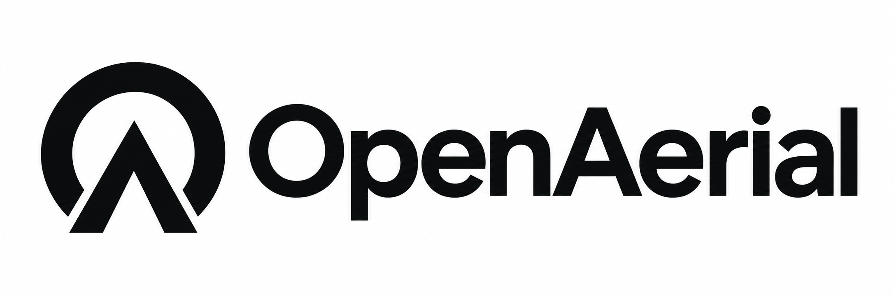

# OpenAerial

[中文](README.md) | [English](README.en.md)

OpenAerial 致力于降低空中智能系统从搭建、开发、训练到部署的整体门槛。我们以可复现、可扩展的无人机参考平台为载体，逐步开放自研机械设计、系统集成方案、软件及仿真、数据、训练与部署流程，让全球开发者、科研团队和高校能够以可负担的成本开展自主飞行研究与应用开发，并共同积累可复用的成果。



## 产品目录

| 产品 | 工作目录 | 状态 | 已发布版本 |
| --- | --- | --- | --- |
| OpenAerial 150 | [openaerial-150](products/openaerial-150/README.md) | 规划中，资料待补充 | 尚未发布 |

本仓库目前提供目录与文档模板。产品规格、设计源文件、代码和验证记录将随研发逐步补充；当前模板不代表已有可制造或可飞行的系统。

## 从哪里开始

- 了解和开发第一款产品：[OpenAerial 150](products/openaerial-150/README.md)。
- 新增产品与组织文件：[产品目录规则](products/README.md)。
- 理解产品与公共模块的边界：[架构与目录约定](docs/architecture.md)。
- 配置工具与提交资料：[开发说明](docs/development.md)和[贡献指南](CONTRIBUTING.md)。
- 准备可复现的版本：[发布流程](docs/releases.md)。
- 确认开放范围与使用条件：[许可说明](docs/licensing.md)。

## 仓库结构

```text
products/          每个产品的结构、电路、BOM、固件、软件及复现资料
shared/            被多个产品实际复用的自研模块
docs/              平台公共文档与协作规则
tools/             跨产品使用的开发、检查和打包工具
resources/         外部数据集、模型权重及大型日志的索引
assets/branding/   Logo 与品牌素材
```

每个产品都有独立入口；公共模块在出现实际复用之后提取。产品版本应明确机械、电路、BOM、软件及验证结果之间的配套关系。

## 文档语言

仓库说明文档提供中文和英文两个版本：默认 `.md` 文件为中文，同目录 `.en.md` 文件为英文。各文档顶部提供语言切换入口。

设计文件、代码、BOM、接线表和配置共用一份，字段采用稳定标识；两种语言的说明文档同步维护。

## 许可

项目各类资产的许可证尚待确定，适用范围记录在[许可说明](docs/licensing.md)。第三方材料应保留原有许可证与署名。
